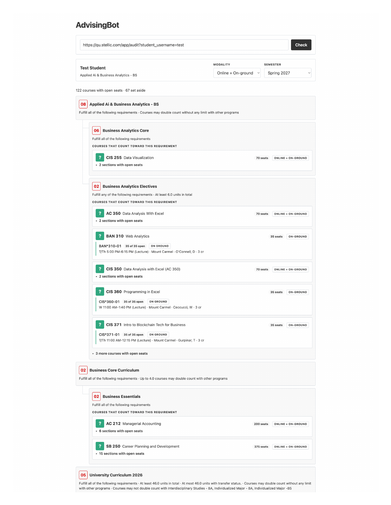

# AdvisingBot

AdvisingBot helps Quinnipiac student advisors turn a student's Stellic degree audit into a clear list of courses with open seats in Self-Service.

It follows the requirement structure in Stellic, so you can see what each course may count toward. A course can appear in more than one place when it can satisfy more than one requirement.

## Install

In Codex, paste this prompt:

```text
Install the advising-report Skill from https://github.com/guidolang/advisingbot/tree/main/skills/advising-report. If OpenTabs needs setup, use https://opentabs.dev/docs/install. Then open AdvisingBot in Chrome.
```

Codex downloads and installs the Skill for you. You do not need to install GitHub, use Terminal, or install Python packages. If Codex asks you to sign in to GitHub, follow that one prompt so it can download the Skill.

The first time you use it, Codex checks the secure connection to Stellic. If anything needs attention, it gives you a plain-language message. You can simply ask Codex to fix the connection for AdvisingBot.

AdvisingBot uses [OpenTabs](https://opentabs.dev/docs/install) to connect securely to Stellic in Chrome. Codex can handle the setup when possible. If Chrome needs a one-time extension confirmation, the OpenTabs guide explains it clearly.

## Use AdvisingBot

1. In Chrome, open the student's degree audit in Stellic.
2. Copy the audit page address (e.g., [https://qu.stellic.com/app/audit?student_username=test](https://qu.stellic.com/app/audit?student_username=test)).
3. Paste it into AdvisingBot and select **Check**.
4. Choose a semester and, when helpful, Online, On-ground, or both.
5. Review the available courses and sections. Use **Copy Notes** when you want a short list to paste elsewhere.

## Example

This example shows a fictitious student report.



## Reading the report

- Requirements follow the order and nesting shown in Stellic.
- Courses appear only when a relevant section has an open seat.
- A course may appear under more than one requirement when it can count toward each of them.
- Courses that have seats but need a prerequisite or adviser review are set aside with a reason.
- A requirement can have no recommendation when no eligible section is open or when Stellic does not identify a specific course well enough to recommend one.

Use the report to support advising. Confirm the student's final eligibility and course fit in Stellic before recommending registration.

## If something goes wrong

| What you see | What to do |
| --- | --- |
| A message asking you to sign in | Sign in to Stellic in Chrome, then select **Check** again. |
| A message about the secure Stellic connection | In Codex, say: **Set up OpenTabs for AdvisingBot.** You can also use the [OpenTabs setup guide](https://opentabs.dev/docs/install). |
| No courses for a requirement | Try a different semester or modality. There may be no open eligible sections, or the requirement may need adviser review. |

The app runs locally. It holds the student's audit in memory for the current check and does not save it to disk. Its local cache contains public course and seat information only.
